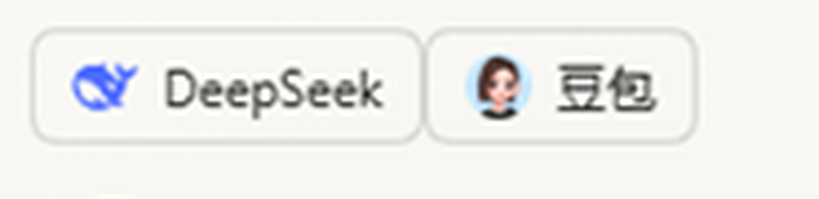

# dsh-web-companion

[](LICENSE)
[](#requirements)
[](https://github.com/deepseek-ai/deepseek-harness)
[](https://nodejs.org)
[](#contributing)

A **DeepSeek Harness** plugin that puts the DeepSeek and Doubao web apps one click away in the
sidebar, and lets the model read answers from the Doubao web app — including **image recognition**.

Both entries and the recognition tool share **one persistent Chromium profile**, so a single
sign-in survives Harness restarts.

> 中文说明见 [README.zh.md](README.zh.md).



## Features

- **One-click web apps** — two entries at the bottom of the left sidebar (root-scoped, so they
  exist even on the new-conversation screen): `DeepSeek` opens `chat.deepseek.com`, `Doubao` opens
  `www.doubao.com/chat/`. No new window per call: one browser, reused.
- **Vision through the Doubao web app** — `doubao_vision` pastes an image into the Doubao composer,
  sends it, and returns the reply text to the harness as a tool result.
- **Persistent login** — the browser runs with a fixed `--user-data-dir`, so cookies and site
  sessions are written to disk and reused across calls and restarts.

## Requirements

| Item | Value |
| --- | --- |
| Harness | DeepSeek Harness **Desktop** (Electron shell), plugin API as of 2026.11 |
| OS | Windows (paths and browser auto-detection are Windows-specific) |
| Browser | A local Edge or Chrome build, or set `browserPath` / `DSH_COMPANION_BROWSER` |
| Node | ≥ 22 in the harness host (the plugin uses the global `WebSocket` and `fetch`) |

## Install

The plugin is a DSH bundle: it is installed from a directory, not from npm.

```bash
# inside the harness
plugin_manager action=install_bundle target=C:\path\to\dsh-web-companion
```

`application: applied` means it is live. To reload after editing:

```bash
plugin_manager action=set_bundle target=@local/dsh-web-companion enabled=false
plugin_manager action=set_bundle target=@local/dsh-web-companion enabled=true
```

To remove it: `plugin_manager action=remove_bundle target=@local/dsh-web-companion`.

The package name stays `@local/dsh-web-companion` because the bundle row and the installed
symlink are keyed by it. The repository itself is distributed under the name `dsh-web-companion`.

## Usage

### Sidebar entries

1. Bottom of the left sidebar: `DeepSeek` and `Doubao`. Each opens its page in the persistent browser.
2. The right sidebar's **Start** tab also carries a *Web companion* card that opens the panel.
3. The panel's own buttons open the same browser; only if the host route is unavailable do they
   fall back to a Harness Browser tab (that partition is ephemeral — you would sign in again).

### Image recognition

Attach an image in the harness, then ask the model to recognise it with Doubao. The model calls:

```json
{ "image_path": "C:\\path\\to\\image.png", "prompt": "What text is in this image? Answer with the text only." }
```

`imageBase64` (raw or a `data:` URL) is accepted instead of `image_path`. The tool returns the
Doubao reply as the tool result, so the model can answer from it.

### Managing the browser

```json
{ "action": "status" }                       // running?, profile dir, open pages
{ "action": "open", "target": "doubao" }     // open or switch to a page
{ "action": "login", "target": "deepseek" }  // open the sign-in page once
```

## How it works

```
sidebar entry / panel  ──fetch──▶  GET /dsh-companion/open?target=…
                                        │
                                        ▼
                              CompanionBrowser (index.js)
                              ├── spawns Edge/Chrome with a persistent profile
                              └── drives it over CDP (127.0.0.1:9334)
                                        │
model ──doubao_vision──▶ paste image + prompt ▶ read reply bubble
```

- **No private APIs.** The Doubao side is driven through the page: a synthetic `paste` event carries
  the image into the ProseMirror composer, `Input.insertText` + `Enter` submit it, and the reply is
  read from `[data-testid=union_message]` → `receive_message` → `message_text_content`.
- **One browser for everything.** `pageFor()` reuses the page already on the target origin, so the
  entry, the panel and `doubao_vision` operate on the same tab and the same cookies.
- **Why not an iframe?** `chat.deepseek.com` sends `Content-Security-Policy: frame-ancestors 'none'`,
  so it cannot be embedded. The plugin opens a real browser page instead.
- **Why a loopback route?** The Web UI's renderer cannot call harness tools directly, but it can
  `fetch()` a route registered through `ctx.webServer`. The route accepts loopback or `null`
  origins only.

## Configuration

`config` in `cordis.patch.yml`:

| Key | Default | Meaning |
| --- | --- | --- |
| `port` | `9334` | CDP port for the plugin browser, bound to `127.0.0.1` |
| `browserPath` | empty | Explicit executable; empty auto-detects Edge, then Chrome |
| `profileDir` | `~/.dsh/web-companion/profile` | Persistent profile directory |
| `hidden` | `false` | Start the window off-screen; keep `false` until the first sign-in |
| `doubaoUrl` / `deepseekUrl` | vendor URLs | Replace if a site moves |
| `replyTimeoutMs` | `180000` | Per-recognition timeout |

## Verification

1. **Entries** — both icons appear at the bottom of the left sidebar, including on the new-conversation
   screen. Clicking one opens the matching page in the persistent browser.
2. **Recognition** — attach an image and ask the model to read it with Doubao; the text comes back as a
   tool result.
3. **Same session** — click `Doubao`, leave the page open, then run a recognition; the conversation
   appears in Doubao's *Recent* list, proving one browser and one profile are shared.
4. **Login reuse** — sign in once, restart the harness, `{ "action": "open" }` again; the page is still
   signed in. Cookies live in `profile/Default/Network/Cookies`.

## Known limitations

- **Site changes break selectors.** Doubao UI updates may require adjusting the `data-testid` names in
  `recognize()` in `index.js`.
- **Captchas** may appear; the tool then times out and the browser window needs one manual action.
- **Windows only** for now: browser auto-detection assumes Windows install paths.
- **Web harness** has no Electron `<webview>`; pages open in the system browser instead.
- Recognition polls the DOM and returns once the reply text is stable (~1.2 s), up to `replyTimeoutMs`.

## Development

| Path | Purpose |
| --- | --- |
| `index.js` | Host half: browser lifecycle, CDP client, tools, loopback route |
| `client.js` | Client half: sidebar entries, right-sidebar panel, inlined logos |
| `cordis.patch.yml` | Loader row and default config |
| `tools/fetch-logos.mjs` | Re-download the vendor favicon assets |
| `tools/embed-logos.mjs` | Inline those assets into `client.js` as data URIs |
| `assets/` | Source artwork for the icons (not loaded at runtime) |

## Trademarks

DeepSeek and Doubao names and logos are trademarks of their respective owners. They are used here
only to identify the services this plugin opens; the favicon copies live in `assets/` and are inlined
for identification purposes.

## License

[MIT](LICENSE)
