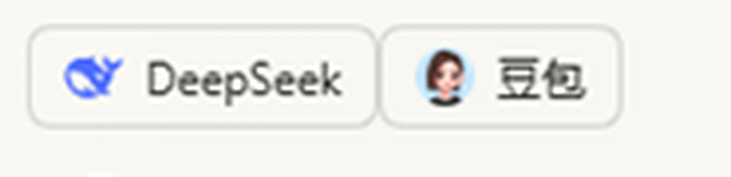

# 网页助手（DeepSeek / 豆包）— DeepSeek Harness 插件

[English](README.md) | 中文

[](LICENSE)
[](#1-前提与假设)
[](https://github.com/deepseek-ai/deepseek-harness)

在 DeepSeek Harness 右侧栏中使用网页版 DeepSeek 提问，并让 Harness 通过网页版豆包识别图片。
一个持久化的浏览器配置目录承接两边的登录状态，登录一次后后续调用复用。

- 宿主侧（`index.js`）：持久化 Chromium + CDP 驱动 + 两个模型工具
- 客户端侧（`client.js`）：右侧栏标签页「网页助手」+ 输入框下方入口按钮
- 清单/注册：`package.json`（`dsh.bundle` / `dsh.client`）+ `cordis.patch.yml`

## 1. 前提与假设

| 项 | 说明 |
| --- | --- |
| 运行环境 | DeepSeek Harness **Desktop**（Electron 外壳）+ Windows + 本机已装 Edge 或 Chrome。已在本机 Edge 151 / Chrome 上验证。 |
| 浏览器 | 插件**不使用** DSH 自带的 Browser 标签页的会话，而是自己启动一个带持久化 `--user-data-dir` 的浏览器进程，因此登录能跨 Harness 重启保留。 |
| 豆包 | 通过页面 DOM（`data-testid`）与合成 `paste` 事件驱动，不调用任何私有接口。访客模式可用；登录后额度更高。 |
| DeepSeek | `chat.deepseek.com` 返回 `Content-Security-Policy: frame-ancestors 'none'`，**禁止被 iframe 嵌入**，因此侧边栏内嵌走 DSH 自带的 Browser 标签页（Electron `<webview>`，不受该限制）。 |
| Web 版 Harness | 浏览器里打开的 Harness 没有 Electron `<webview>`，DeepSeek 只能退化为「系统浏览器打开」，插件面板会提示。 |

## 2. 安装

插件已按 DSH 插件规范放在 `plugins/dsh-web-companion`（工作区内，可纳入版本管理）。

```bash
# 在 Harness 中安装（会写 profile 的 package.json / cordis.patch.yml 并建立软链）
plugin_manager install_bundle  target=C:\...\default-workspace\plugins\dsh-web-companion
```

安装后 `application: applied` 即生效；若只是改了代码，用同一 `target` 再 install 会提示已安装，
此时用 `plugin_manager set_bundle target=@local/dsh-web-companion enabled=false` → `enabled=true` 重新加载。

卸载：`plugin_manager remove_bundle target=@local/dsh-web-companion`。

## 3. 使用

### 3.1 侧边栏

1. **左侧栏底部工具栏**有两个一键入口：「🌐 DeepSeek」打开 `chat.deepseek.com`，「🫘 豆包」打开
   `www.doubao.com/chat/`，都落在**同一个持久化浏览器**里，登录一次长期有效。
   两个入口都是 root 作用域，所以**新对话界面（还没有会话）也照样存在**。
2. 右侧栏「开始」页签里有「网页助手」卡片，点开即进入面板。
3. 面板里点「在侧边栏打开 DeepSeek / 豆包」同样走持久化浏览器；
   只有宿主路由不可用时才退化为 DSH 的 Browser 标签页（重启需重登）。

### 3.2 豆包识图（由 Harness 读取结果）

直接对模型说：先上传图片，再说「用豆包识别这张图里的文字」。模型会调用 `doubao_vision` 工具：

```json
{ "image_path": "C:\\path\\to\\image.png", "prompt": "这张图里写了什么字？只回答图中的文字。" }
```

工具把图片粘贴进豆包网页 → 发送 → 读取回复气泡 `[data-testid=message_text_content]` 的文本 →
作为工具结果返回，模型据此回答。也可以直接给 `imageBase64`（可带 `data:` 前缀）。

### 3.3 管理持久化浏览器

```json
{ "action": "status" }                       // 是否在运行、profile 目录、已开页面
{ "action": "open", "target": "doubao" }     // 打开/切换页面
{ "action": "login", "target": "deepseek" }  // 打开登录页，登录一次即可
```

## 4. 登录状态如何持久化

- 浏览器以 `--user-data-dir=%USERPROFILE%\.dsh\web-companion\profile` 启动，Cookie、localStorage、
  站点权限全部落在该目录；插件每次调用只复用同一个 profile，不清理、不换目录，**Harness 重启也不影响**。
- 已在真机验证：在插件浏览器里写入一个带过期时间的 Cookie → 关闭整个浏览器进程 → 由工具重新拉起
  → 同一 Cookie 仍存在（`persisted-42`）。profile 的 `Default/Network/Cookies` 中也长期保留
  `ttwid`、`.doubao.com` 等站点会话，说明登录态确实落盘。
- 想重置登录：关闭该浏览器窗口后删除上述 `profile` 目录即可。
- **默认路径**：面板按钮与左侧栏「网页助手」入口都走持久化浏览器，登录一次、重启不掉。
  只有当宿主本地路由不可达时，才退化为 DSH 自带的 Browser 标签页——那个分区每次启动随机生成、
  不落盘，重启后需要重新登录。

## 4.5 品牌图标

侧边栏两个入口用的是各自站点发布的官方图标的本地副本，内联为 data URI（不依赖网络，也不会在运行时加载第三方资源）：



| 入口 | 素材来源 | 本地文件 |
| --- | --- | --- |
| DeepSeek | `https://fe-static.deepseek.com/chat/favicon.svg` | `assets/deepseek.svg` |
| 豆包 | `https://lf-flow-web-cdn.doubao.com/obj/flow-doubao/favicon/new-doubao/128x128.png`（降到 32px） | `assets/doubao-32.png` |

素材由 `tools/fetch-logos.mjs` 抓取、`tools/embed-logos.mjs` 内联进 `client.js`。
DeepSeek、豆包的名称与图标是各自权利人的商标，此处仅用于标识对应服务。

## 5. 配置（`cordis.patch.yml` 的 `config`）

| 键 | 默认 | 说明 |
| --- | --- | --- |
| `port` | 9334 | 本机 CDP 端口，仅监听 127.0.0.1 |
| `browserPath` | 空 | 留空自动找 Edge→Chrome；也可用环境变量 `DSH_COMPANION_BROWSER` |
| `profileDir` | `~/.dsh/web-companion/profile` | 持久化目录 |
| `hidden` | `false` | 把窗口移到屏幕外；首次登录请保持 `false` |
| `doubaoUrl` / `deepseekUrl` | 官网地址 | 站点改版时可直接替换 |
| `replyTimeoutMs` | 180000 | 单次识图等待上限 |

## 6. 功能验证

1. **侧边栏入口**：左侧栏底部出现「DeepSeek」与「豆包」两个图标按钮；新对话界面（无会话）也可见。
   点击任一按钮 → 持久浏览器打开对应网页。
2. **识图**：把一张含文字的图片交给模型，说「用豆包识别这张图里的文字」，
   `doubao_vision` 返回图中文字，并作为工具结果出现在对话里。
3. **同一会话**：点「豆包」入口后不要关页面，直接触发一次识图；打开豆包「最近」会话列表，
   能看到刚才那轮问答——说明入口与识图共用同一个浏览器进程、同一个 profile。
4. **登录复用**：
   ```bash
   # 查看持久浏览器状态（运行中、profile 路径、已开页面）
   web_companion { "action": "status" }
   ```
   登录一次后重启 Harness，再用 `web_companion { "action": "open" }` 打开，
   页面仍是登录态；profile 位于 `~/.dsh/web-companion/profile`，其中 `Default/Network/Cookies`
   长期保留站点会话。

> 素材脚本：`tools/fetch-logos.mjs` 重新抓取官方图标，`tools/embed-logos.mjs` 将它们内联进 `client.js`。

## 7. 边界与已知限制

- **站点改版**：豆包前端若改动 `data-testid`，识图会失效；选择器集中在 `index.js` 的 `recognize()`
  一处（`union_message` / `receive_message` / `message_text_content`），改一处即可。
- **验证码/风控**：豆包可能要求人工验证；此时工具会报超时，需在弹窗浏览器里人工处理一次。
- **首次登录**：DeepSeek 网页必须登录才能提问；豆包访客可用但有额度限制。
- **不强依赖私有接口**：全部通过页面 DOM 与标准输入事件，平台若改内部接口不影响本方案。
- **Web 版 Harness**：无 Electron `<webview>`，DeepSeek 无法侧边栏内嵌（CSP 限制），面板会提示改用
  系统浏览器；豆包可走普通 iframe。
- 识图是同步轮询页面文本：长回答会等到回复稳定（约 1.2s 无变化）才返回，超时上限可配。
